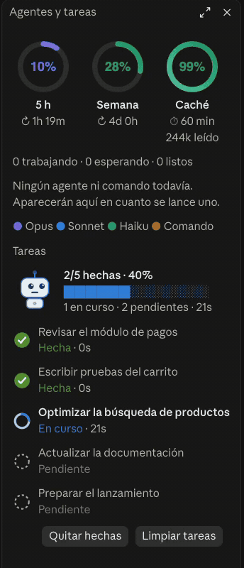

# claude-code-mods

Dos mods para Claude Code que muestran en pantalla lo que normalmente no se ve: qué hacen tus subagentes, cuánto te queda de cuota y cómo va la caché de prompts.

<p align="center"></p>

*El panel de `agent-bots` en la app de escritorio, con agentes y tareas de ejemplo.*

<p align="center"><a href="docs/brag.mp4"></a><br><sub>▶ Ver el video de presentación (23 s)</sub></p>

> **Aviso:** la API de mods de Claude Code es de acceso anticipado y puede cambiar entre versiones. Probados con Claude Code 2.1.292 y 2.1.299.

| Mod | Qué hace | Dónde se ve |
| --- | --- | --- |
| [`agent-bots`](agent-bots) | Panel lateral «Agentes y tareas»: cada subagente (y cada comando en segundo plano) como un robot animado, la lista de tareas de la sesión en vivo y tres anillos: cuota de 5 h, cuota semanal y caché de prompts. Avisa al terminar el plan o un agente en segundo plano, marca «¿Colgado?» al robot que lleva demasiado sin señales y advierte si el mod está cargado dos veces | App de escritorio (en terminal, versión de texto) |
| [`medidor`](medidor) | Banda sobre el prompt: modelo y esfuerzo, contexto, límites de 5 h y semana con su reinicio, costo, duración y estado de la caché con cuenta regresiva | Terminal |

Los dos se complementan: `medidor` solo dibuja en la terminal y `agent-bots` hace lo mismo en la app de escritorio. Puedes instalar solo uno.

## Instalación

```text
/plugin marketplace add gabriel9004/claude-code-mods
/plugin install agent-bots@claude-code-mods
/plugin install medidor@claude-code-mods
/reload-plugins
```

Luego `/tareas` o `/bots` abre el panel y `/medidor [completo|compacto|oculto]` cambia la banda.

## Qué lee cada mod

Un mod se ejecuta con acceso a la sesión, así que conviene saber qué toca. Ninguno envía datos a ningún sitio ni guarda nada en disco.

- **agent-bots:** los subagentes y herramientas que usa la sesión, la lista de tareas, los porcentajes de cuota (`session.usage`), el uso de tokens de cada petición para la caché y tres variables de entorno de solo lectura (`FORCE_PROMPT_CACHING_5M`, `CLAUDE_CODE_PROMPT_CACHE_TTL`, `ENABLE_PROMPT_CACHING_1H`). Registra una herramienta propia, `tareas`, y solo añade una línea al prompt de sistema si la sesión no trae ninguna herramienta de tareas.
- **medidor:** modelo, esfuerzo, uso de contexto y de cuota, costo, tokens de cada petición y las mismas tres variables de entorno.

## Desarrollo

Cada mod trae sus pruebas:

```bash
cd agent-bots && claude plugin validate . && claude plugin test .
cd ../medidor && claude plugin validate .
```

## Licencia y créditos

MIT. La lógica de la caché toma ideas de otro proyecto MIT; ver [NOTICE.md](NOTICE.md).

---

## English

Two Claude Code mods: `agent-bots` (a desktop side panel with animated robots for subagents, a live task list and quota/cache rings) and `medidor` (a terminal band with model, context, 5 h / weekly limits, cost and prompt-cache countdown). The mods API is early access and may change.

```text
/plugin marketplace add gabriel9004/claude-code-mods
/plugin install agent-bots@claude-code-mods
/plugin install medidor@claude-code-mods
```

MIT licensed. The UI text is in Spanish.
